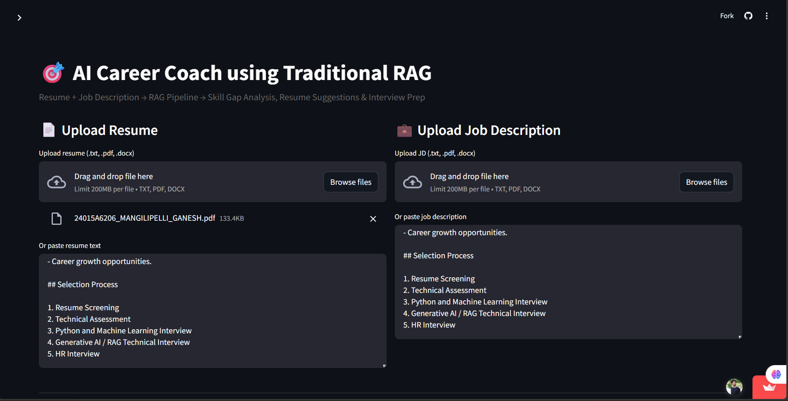
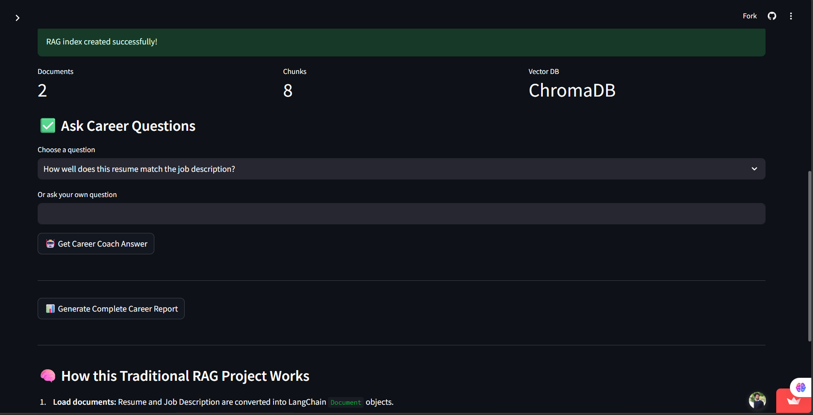
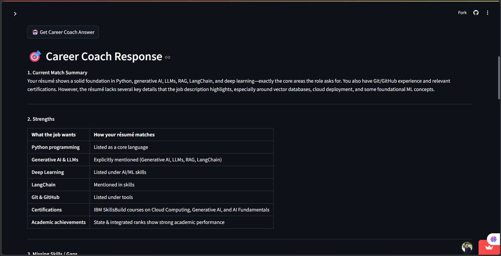
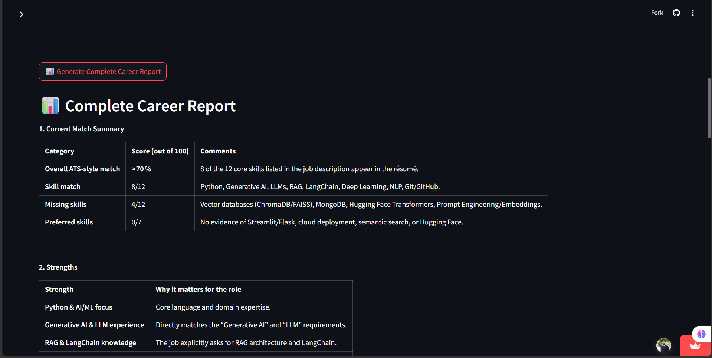

# 🎯 AI Career Coach – Traditional RAG Application

An AI-powered career coaching application built using **Retrieval-Augmented Generation (RAG)** that analyzes resumes against job descriptions, identifies skill gaps, provides personalized resume improvement suggestions, and generates interview preparation guidance.

<p align="center">
  <a href="https://ai-career-coach-nfjbk5eb85tua2veucjvvb.streamlit.app/">
    <strong>🚀 Try Live Application</strong>
  </a>
</p>

---

## 🌐 Live Demo

**Application:** https://ai-career-coach-nfjbk5eb85tua2veucjvvb.streamlit.app/

Upload your resume and a job description to receive AI-powered career recommendations.

---

## 📌 Project Overview

Choosing the right career path and understanding job requirements can be challenging for students and freshers.

This project addresses that problem by using Traditional RAG architecture to analyze two documents:

- Candidate Resume
- Job Description (JD)

The application retrieves relevant information from both documents and uses a Large Language Model (LLM) to generate context-aware career guidance.

Instead of generating generic suggestions, it uses the uploaded documents as its knowledge base.

## ✨ Key Features

- 📄 **Resume Analysis:** Upload resumes in PDF, DOCX, or TXT format.
- 💼 **Job Description Analysis:** Upload or paste job descriptions.
- 🔍 **Skill Gap Analysis:** Identify matching and missing skills.
- 📊 **ATS-Style Match Analysis:** Get an estimated resume-to-job match score.
- 📝 **Resume Improvement:** Receive suggestions to improve your resume.
- 🚀 **Project Recommendations:** Discover projects to strengthen your technical profile.
- 🎯 **Interview Preparation:** Generate relevant technical interview questions.
- 🤖 **AI Career Assistant:** Ask custom questions about your career and job requirements.
- 📑 **Complete Career Report:** Generate a comprehensive career analysis report.

## 🧠 How Traditional RAG Works

The application follows a traditional Retrieval-Augmented Generation pipeline.

### RAG Architecture

1. **Document Loading:** Resume and job description are loaded and converted into LangChain Document objects.
2. **Text Chunking:** Large documents are divided into smaller chunks using RecursiveCharacterTextSplitter.
3. **Embeddings Generation:** Hugging Face converts text chunks into numerical vector representations.
4. **Vector Storage:** Embeddings and document chunks are stored in ChromaDB.
5. **Query Embedding:** The user's career question is converted into an embedding.
6. **Similarity Search:** ChromaDB retrieves the most relevant chunks from the uploaded documents.
7. **LLM Generation:** Groq-powered Llama generates career guidance using the retrieved context.

### RAG Workflow

```text
        Resume + Job Description
                   |
                   v
           Document Loading
                   |
                   v
             Text Chunking
                   |
                   v
          Hugging Face Embeddings
                   |
                   v
              ChromaDB
            Vector Storage
                   |
                   v
           User Career Query
                   |
                   v
            Query Embedding
                   |
                   v
           Similarity Search
                   |
                   v
          Retrieved Context
                   |
                   v
             Groq LLM
                   |
                   v
          Career Coach Response
```

## 🛠️ Technology Stack

| Category | Technologies |
|---|---|
| Programming Language | Python |
| Frontend | Streamlit |
| LLM | Groq – Llama |
| Framework | LangChain |
| Embeddings | Hugging Face |
| Embedding Model | all-MiniLM-L6-v2 |
| Vector Database | ChromaDB |
| Document Processing | PyPDF, docx2txt |
| Environment Management | Python Virtual Environment |
| Version Control | Git & GitHub |
| Deployment | Streamlit Community Cloud |
## 📸 Application Screenshots









## 📂 Project Structure

```text
AI-Career-Coach/
│
├── app.py
│
├── src/
│   ├── __init__.py
│   ├── rag_engine.py
│   └── file_utils.py
│
├── data/
│   └── Sample Documents
│
├── career_coach_chroma_db/
│
├── requirements.txt
│
├── .env
│
├── .gitignore
│
└── README.md
```

## ⚙️ Installation and Setup

### 1. Clone the Repository

```bash
git clone https://github.com/Ganeshmangilipelli/AI-Career-Coach.git
```

### 2. Navigate to the Project Directory

```bash
cd AI-Career-Coach
```

### 3. Create a Virtual Environment

```bash
python -m venv venv
```

### 4. Activate the Virtual Environment

**Windows PowerShell:**

```bash
venv\Scripts\activate
```

### 5. Install Dependencies

```bash
pip install -r requirements.txt
```

### 6. Configure Groq API Key

Create a `.env` file in the root directory.

```env
GROQ_API_KEY=your_groq_api_key
```

Get your API key from: https://console.groq.com/keys

### 7. Run the Application

```bash
streamlit run app.py
```

The application will open in your browser.

## 🎯 Example Use Cases

- Students preparing for campus placements.
- Freshers evaluating their resumes against job descriptions.
- Candidates identifying missing technical skills.
- Job seekers preparing for technical interviews.
- Developers planning their next learning steps.

## 🚀 Future Enhancements

- Integration with multiple LLM providers.
- Advanced resume parsing and analysis.
- Support for multiple job descriptions.
- Downloadable PDF career reports.
- Conversational career assistant with chat history.
- Advanced semantic search and retrieval optimization.
- Integration with job portals and career platforms.

## 👨‍💻 Author

**Ganesh Mangilipelli**

Aspiring AI Engineer | Generative AI | Machine Learning | RAG Applications

- GitHub: https://github.com/Ganeshmangilipelli
- Project Repository: https://github.com/Ganeshmangilipelli/AI-Career-Coach
- Live Application: https://ai-career-coach-nfjbk5eb85tua2veucjvvb.streamlit.app/

---

⭐ If you find this project interesting, consider giving it a star!
